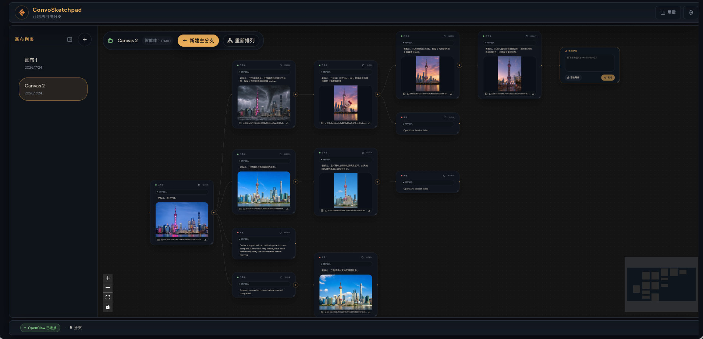

<div id="top" align="center">
  

# ConvoSketchpad

**让想法自由分支 · Let ideas fly free**

**一张画布，多条思路，熟悉的 Agent**

**One canvas. Many paths. The agents you know.**

[](https://github.com/MrToyy/convosketchpad)
[](LICENSE)

[中文](#中文) · [English ↓](#english)
</div>

<p align="center">
  <a href="./public/screenshot.png">
    
  </a>
</p>

<a id="中文"></a>

## 中文

ConvoSketchpad 是一张用于分支 AI 对话的自托管可视化画布。你可以从任意已完成节点展开、比较和继续不同思路，同时直接使用已经配置好的 OpenClaw、Codex 或 OpenCode 运行环境，以及其中已有的 Agent、模型、技能、记忆、插件和工具。

> [!IMPORTANT]
> ConvoSketchpad **不是独立的 Agent 运行环境**，也不负责运行模型、工具或 Agent。它必须连接至少一个 Agent 运行端（Agent Runtime）。当前 v0.5.0 支持 [OpenClaw](https://github.com/openclaw/openclaw) Gateway、本地 Codex App Server，以及测试阶段的本地 OpenCode Server；Agent、工具调用、Conversation 和原始运行记录由运行端提供。

> [!TIP]
> 这种架构带来两个互补优势：Canvas 分支把不同探索隔离在各自的上下文链路中，保护任务主线；连接现有 Agent Runtime，则让你直接复用自己已经配置好、也已经熟悉的 Agent，以及运行端为它们提供的模型、技能（Skills）、记忆（Memory）、插件和工具，无需在 ConvoSketchpad 中重新搭建或维护一套 Agent 环境。

### 与普通线性 AI 聊天有什么不同

| | 普通线性 AI 聊天 | ConvoSketchpad |
|---|---|---|
| 展开思路 | 所有问题沿一条消息流继续 | 从任意已完成节点创建分支，在画布上并行探索 |
| 保护主线 | 临时试验和补充询问会进入后续对话 | 每条分支保留自己的提示词、回复、附件和生成结果 |
| 使用 Agent | 取决于聊天产品内置的模型和工具 | 直接沿用 OpenClaw、Codex 或 OpenCode 中已有的 Agent/默认配置、技能、记忆、插件和工具 |
| 回顾过程 | 在长聊天记录中滚动查找 | 在可缩放画布上查看、移动和比较不同路径 |

Agent Runtime 中的单个 Conversation 通常以线性消息流推进。在同一条对话中穿插创意试验、图片生成、临时调研或补充提问时，这些过程都会进入后续对话，逐渐稀释主线目标；如果另开 Conversation，又需要重新整理分叉点之前的背景。

ConvoSketchpad 把这些方向铺展在同一张 Canvas 上：从任意已完成的 Interaction 带着当时信息创建新方向，独立试验，再继续真正值得推进的路径。探索过程彼此清晰，也不会挤乱主线。

### 适合谁

- **自媒体与内容创作者（优先推荐）**：围绕选题、叙事、文案和视觉风格并行尝试多个方向，在不同分支生成和比较图片，同时继续使用运行端中已经配置的 Agent、插件、技能与工具。
- **研究、产品及其他知识工作者**：让主线专注于目标任务，把临时调研、验证和补充询问放到侧支；得到答案后，再将筛选、整理过的结论带回主线，避免过程信息持续占用核心上下文。
- **已经使用 OpenClaw、Codex 或 OpenCode 的用户**：保留熟悉的 Agent 或默认模型、技能、记忆、审批策略和工具，只增加可视化分支与 Canvas 组织方式，无需迁移到第二套 Agent 环境。

### 核心能力

- 在一个可平移、缩放的 Canvas 中创建多个根分支。
- 以仅追加方式组织交互，明确区分“继续”和“分支”。
- 从任意已完成的交互携带当时上下文创建试验分支。
- setup 配置需要连接的 Agent 运行端，所有运行端提供的 Agent 平权进入统一目录。
- 新 Canvas 自动选择 setup 配置的可用默认 Agent，不可用时回退到第一个可用项；首次发送前可更换，发送预留创建后即锁定。
- 继续使用所选运行端已配置的 Agent、模型、插件、技能、记忆与工具，无需维护第二套运行环境。
- 持久化保存用户附件和生成的 Artifact，并按用户隔离。
- 当运行端替换或移除分支 Conversation 时，通过规范快照恢复上下文。
- 在所属 Interaction 节点内处理 Agent 的审批请求，并对持久授权进行二次确认。
- 支持可选的受管用户登录、会话撤销、限流和 Canvas 隔离。
- 前端界面支持中文和英文，并默认使用中文。

```text
Canvas
├── 根分支 A：交互 1 ── 交互 2 ── 交互 3
│                           └────── 分支 B
└── 根分支 C：交互 4 ── 交互 5
```

### 环境要求

- macOS 或 Linux
- Node.js 22.22.2 或更高版本
- npm 和 Git
- 至少一个已配置且可访问的 Agent 运行端：OpenClaw Gateway、已登录的本地 Codex CLI `0.146.0+`，或已配置默认模型的本地 OpenCode `1.18.16+`

### 快速安装

推荐使用安装脚本：

```bash
curl -fsSL https://raw.githubusercontent.com/MrToyy/convosketchpad/main/install.sh | bash
```

安装脚本默认解析最新的官方稳定 Release。开发版安装需要显式指定 `--branch main`。完整参数请参阅[安装文档](docs/INSTALL.md)。

手动安装：

```bash
git clone https://github.com/MrToyy/convosketchpad.git
cd convosketchpad
npm install
npm run setup
npm run build
npm start
```

`npm run setup` 会先探测并多选 Agent 运行端，再逐项配置连接，随后配置访问方式和可选的受管用户认证，最后从统一 Agent 目录选择新建 Canvas 的默认 Agent。Codex 接入直接监督本机 `codex app-server`；OpenCode 接入监督本机 `opencode serve` 并沿用其默认模型。安装或启动本项目不会替代 Agent 运行端。

### 运行关系

```text
React Canvas ── HTTP/SSE ── ConvoSketchpad 服务端 ── Agent Runtime Port
                              │                       ├─ OpenClaw Adapter ⇄ Gateway
                              │                       ├─ Codex Adapter ⇄ 本地 App Server
                              │                       └─ OpenCode Adapter ⇄ 本地 HTTP/SSE Server
                              └──────── SQLite + Artifact 存储
```

Agent 运行端负责 Agent 执行、工具、Conversation 和原始运行记录；ConvoSketchpad 负责 Canvas 拓扑与布局、发送预留、恢复元数据、用户隔离，以及附件和 Artifact 的持久化副本。具体协议和凭据由各 Adapter 封装，Canvas 通用层不依赖 OpenClaw、Codex、OpenCode 等原生方法名。

### 当前支持与后续计划

#### 已支持的 Agent 运行端

| 状态 | Agent 运行端 | 兼容范围 | 主要能力 |
|---|---|---|---|
| 已支持 | **OpenClaw Gateway** | v0.4.0 起；当前验证基线为 OpenClaw `2026.6.8` | 多 Agent Profile、Conversation、附件、Artifact、用量、连接状态和节点内审批。setup 尚未强制最低 OpenClaw 版本，更早版本不在 Release 兼容保证内 |
| 已支持 | **Codex App Server** | v0.4.0 起；Codex CLI `0.146.0+` | 一个共享宿主机账户的 Codex Agent、Thread 恢复、文本/图片输入、流式输出、图片与通用 Artifact、用量/额度和节点内审批 |
| 测试能力 | **OpenCode Server** | OpenCode `1.18.16+` | 单一 `opencode/default`、Session/Message 恢复、全部附件类型透传、流式输出、审批与 Artifact。图片生成取决于默认模型或第三方 MCP/工具 |

#### 候选 Agent 运行端

以下运行端正在评估，不代表已经适配或承诺具体版本。评估顺序以图片设计用途的直接性为准：原生图片生成/编辑优先于明确的设计工作流和多模态输入，仅能通过外部 MCP 扩展图片能力的候选排在后面。

| 评估顺序 | 候选 Runtime | 图片设计适用性 | 基本接入条件 |
|---:|---|---|---|
| 1 | [CodeBuddy Code](https://www.codebuddy.ai/docs/cli/cli-reference) | CLI [内置 `ImageGen`、`ImageEdit` 和 `VideoGen`](https://www.codebuddy.ai/docs/cli/tools-reference)，支持文生图、图生图和图片编辑，也能[处理多图片上下文](https://www.codebuddy.ai/docs/cli/common-workflows)，最贴近图片设计主流程 | 具备 ACP、REST API、Agent SDK、`stream-json` 和后台服务，结构化接入条件较完整 |
| 2 | [Qoder CLI](https://docs.qoder.com/en/cli/quick-start) | Qoder 提供面向海报、横幅和落地页的 [Design 工作台](https://docs.qoder.com/qoderwork/design)，CLI 的 [ACP 也明确支持图片](https://docs.qoder.com/en/cli/acp)；仍需确认设计产物能否通过 CLI/ACP 完整导出 | 具备 Agent SDK、ACP、流式消息、Session 和权限回调，结构化接入条件较完整 |
| 3 | [Kimi Code](https://www.kimi.com/code/docs/en/kimi-code-cli/reference/kimi-command.html) | 原生支持[图片和视频输入](https://www.kimi.com/code/docs/en/kimi-code-cli/guides/interaction)、媒体文件读取，并可通过 [MCP](https://www.kimi.com/code/docs/en/kimi-code-cli/customization/mcp.html) 接入图片生成与编辑工具 | 具备 ACP JSON-RPC，以及本地 REST 与 WebSocket API，结构化接入条件较完整 |
| 4 | [Claude Code](https://code.claude.com/docs/en/cli-usage) | 支持[在终端输入截图、UI Mockup 和 Figma 导出图](https://code.claude.com/docs/en/common-workflows)，并可通过 [MCP](https://code.claude.com/docs/en/agent-sdk/mcp) 调用图片生成或设计工具 | 具备 Agent SDK、`stream-json`、Session 恢复和权限回调，结构化接入条件较完整 |

新运行端必须优先通过 App Server、ACP、Gateway、SDK 或稳定的机器可解析无头模式接入，不解析终端 UI 或非稳定 stdout。图片能力还必须覆盖输入媒体、生成或编辑工具调用、二进制 Artifact 发现与持久化；正式实现仍以事件完整性、审批安全、Session 恢复和 Adapter 一致性测试为准。

#### 产品能力状态与路线图

产品能力按“资源引用 → 分支合并 → 跨 Agent 交接”推进，Windows 支持排在其后。资源引用第一阶段已在 `v0.5.0` 实现，后续阶段的详细边界见[资源引用与后续 Canvas 能力规划](docs/canvas/RESOURCE-REFERENCES.md)。

- **已实现：`@` 资源引用**：在输入指定位置引用本次附件或当前节点父链上游的图片、附件和节点产物；同一资源可多次出现但只占一个槽位，本轮最多九项，并保留所有者、路径与运行端能力校验。
- **下一阶段：分支合并**：选择一个或多个分支生成新的 Interaction，保留来源和历史，不改写既有 Conversation。
- **后续阶段：跨 Agent 交接**：把一个分支的阶段性结果交给另一个 Agent 继续处理，同时保留来源、相关上下文和执行归属。
- **Windows 支持**：补齐 Windows 原生安装、setup、服务管理、路径与权限处理、Runtime 探测以及构建和自动化测试，使其达到与 macOS、Linux 一致的受支持状态。

### 开发调试

```bash
npm install
npm run setup
npm run dev
```

`npm run dev` 会同时启动 Vite 客户端和监听模式服务端，只需打开终端中标记为 `Open in browser` 的地址：

- `HOST` 和 `PORT` 在开发、生产中都表示浏览器访问的 ConvoSketchpad 入口，默认是 `127.0.0.1:3080`。
- `/api` 和 `/health` 会由 Vite 代理到内部服务端；浏览器不直接连接任何 Agent Runtime。
- 内部服务端只绑定 loopback，端口由开发脚本自动选择，无需配置。
- React 客户端支持 HMR；服务端代码变更后由 `tsx watch` 自动重启。

自定义开发地址：

```bash
PORT=4000 npm run dev
```

此时浏览器入口是 `http://127.0.0.1:4000`。需要从 LAN 或 Tailscale 访问时，请重新运行 setup 选择对应访问模式，让 `HOST`、`ALLOWED_ORIGINS` 和认证策略保持一致。修改环境变量后需要重新启动开发进程。

### 常用命令

| 命令 | 用途 |
|---|---|
| `npm run dev` | 同时启动支持热更新的客户端和服务端 |
| `npm run setup` | 运行安装与连接配置向导 |
| `npm run build` | 构建生产版客户端、服务端和 CLI |
| `npm start` | 启动已构建的生产服务 |
| `npm run prod` | 构建并立即启动生产服务 |
| `npm run users -- <command>` | 管理受管用户 |
| `npm run update` | 更新已安装的 ConvoSketchpad |
| `npm test -- --run` | 运行一次完整测试 |
| `npm run lint` | 执行代码检查 |

### 核心配置

复制 `.env.example` 或运行 `npm run setup` 生成 `.env`。以下仅列出最常用的配置：

| 环境变量 | 默认值 | 用途 |
|---|---|---|
| `AGENT_RUNTIMES` | `openclaw` | 启用的 Agent 运行端，按顺序组成统一 Agent 目录 |
| `CONVOSKETCHPAD_DEFAULT_AGENT_RUNTIME` | 未设置 | 新建 Canvas 优先使用的 Agent 运行端 |
| `CONVOSKETCHPAD_DEFAULT_AGENT_PROFILE` | 未设置 | 新建 Canvas 优先使用的 Agent Profile；不可用时回退 |
| `OPENCLAW_GATEWAY_URL` | `http://127.0.0.1:18789` | OpenClaw Gateway 地址 |
| `OPENCLAW_GATEWAY_TOKEN` | 空 | 仅供服务端使用的 Gateway 共享 Token；本机 RPC、Gateway HTTP 与远程配对 bootstrap 使用 |
| `CODEX_BIN` | `codex` | Codex CLI 命令或绝对路径；最低且已验证版本为 `0.146.0` |
| `OPENCODE_BIN` | `opencode` | OpenCode CLI 命令或绝对路径；最低且已验证版本为 `1.18.16` |
| `HOST` | `127.0.0.1` | 开发与生产统一的浏览器入口监听地址 |
| `PORT` | `3080` | 开发与生产统一的浏览器入口端口 |
| `CONVOSKETCHPAD_AUTH` | `false` | 是否启用受管用户认证 |
| `CONVOSKETCHPAD_DATA_DIR` | `~/.convosketchpad` | ConvoSketchpad 自有状态目录 |

Codex 与 OpenCode 固定共用 `~/.convosketchpad/workspace`，setup 按需创建；该路径不提供环境变量覆盖。

对外提供服务前，请启用受管用户认证，并通过反向代理或 Tailscale Serve 提供 HTTPS；ConvoSketchpad 自身只监听 HTTP。请仔细配置精确 Origin、可信代理与网络访问策略。完整说明请参阅[配置文档](docs/CONFIGURATION.md)、[部署文档](docs/DEPLOYMENT.md)和[安全文档](docs/SECURITY.md)。

### 文档

产品与架构：

- [产品目标与原则](docs/PRODUCT.md)
- [架构、Session 与运行时数据流](docs/ARCHITECTURE.md)
- [Canvas 功能索引](docs/canvas/README.md)

安装与运维：

- [文档总索引](docs/README.md)
- [安装](docs/INSTALL.md)
- [部署](docs/DEPLOYMENT.md)
- [配置](docs/CONFIGURATION.md)
- [安全](docs/SECURITY.md)
- [故障排查](docs/TROUBLESHOOTING.md)
- [更新](docs/UPDATING.md)
- [HTTP API](docs/API.md)

维护者参考：

- [Canvas 功能与代码地图](docs/canvas/CANVAS-CODE-MAP.md)
- [认证功能与代码地图](docs/canvas/AUTH-CODE-MAP.md)
- [Git 工作流](docs/canvas/GIT-WORKFLOW.md)

### 许可证

本项目采用 [MIT License](LICENSE)。第三方来源与版权说明见
[NOTICE](NOTICE.md)。

<p align="right"><a href="#top">返回顶部 ↑</a> · <a href="#english">跳转到 English ↓</a></p>

---

<a id="english"></a>

## English

ConvoSketchpad is a self-hosted visual canvas for branching AI conversations. Fork, compare, and continue different paths from any completed node while reusing your existing OpenClaw, Codex, or OpenCode environment and its Agents, default model, skills, memory, plugins, and tools.

> [!IMPORTANT]
> ConvoSketchpad is **not a standalone Agent runtime** and does not run models, tools, or Agents by itself. It must connect to at least one Agent Runtime. Version 0.5.0 supports the [OpenClaw](https://github.com/openclaw/openclaw) Gateway, a local Codex App Server, and an experimental local OpenCode Server; the Runtime provides Agents, tool execution, Conversations, and authoritative run records.

> [!TIP]
> This architecture provides two complementary advantages: Canvas branches isolate different explorations in their own context chains to protect the primary task, while connecting an existing Agent Runtime lets you reuse the Agents you have already configured and know well, together with the models, skills, memory, plugins, and tools the Runtime provides for them—without rebuilding or maintaining a separate Agent environment inside ConvoSketchpad.

> [!NOTE]
> Most detailed project documentation is written in Chinese. English-speaking developers are encouraged to use a capable large language model to translate and explain the documents while preserving code identifiers, commands, environment variables, and OpenClaw protocol names.

### How it differs from linear AI chat

| | Linear AI chat | ConvoSketchpad |
|---|---|---|
| Explore ideas | Every question continues in one message stream | Fork any completed node and explore paths in parallel on a Canvas |
| Protect the main line | Experiments and side questions enter later conversation history | Each branch keeps its own prompts, responses, attachments, and generated results |
| Use Agents | Depends on the models and tools built into the chat product | Reuse existing OpenClaw, Codex, or OpenCode Agents/defaults, skills, memory, plugins, and tools |
| Review the work | Scroll through a long chat history | View, move, and compare paths on a zoomable Canvas |

An Agent Runtime Conversation usually advances as a linear message stream. When creative experiments, image generation, quick research, and side questions all happen in one chat, they become part of everything that follows and gradually dilute the primary objective. Starting a separate Conversation avoids that mixture, but requires reconstructing the information available at the fork point.

ConvoSketchpad lays those directions out on one Canvas. Fork any completed Interaction with the information available at that point, experiment independently, and continue only the paths worth pursuing. Each exploration stays clear without crowding the main line.

### Who it is for

- **Social media and content creators (recommended first)**: explore topics, narratives, copy, and visual styles in parallel; generate and compare images across branches; and keep using the Agents, plugins, skills, and tools already configured in the selected Runtime.
- **Researchers, product teams, and other knowledge workers**: keep the primary branch centered on the target task, move temporary research, validation, and side questions into branches, then summarize selected findings back into the main line.
- **Existing OpenClaw, Codex, or OpenCode users**: keep familiar Agents or default models, skills, memory, approval policies, and tools while adding visual branching and Canvas organization instead of migrating to a second Agent environment.

### Core capabilities

- Create multiple root branches on one pan-and-zoom Canvas.
- Organize append-only Interactions with explicit Continue and Fork semantics.
- Fork any completed Interaction with its context for independent experiments.
- Configure Agent Runtimes during setup and use all discovered Agents through one equal, unified catalog.
- Select the configured default Agent for a new Canvas, fall back to the first available Agent, allow changes before the first send, and lock it when a send reservation is created.
- Keep using the Agents, models, plugins, skills, memory, and tools configured in the selected Runtime without maintaining a second execution environment.
- Keep durable, owner-scoped copies of user attachments and generated Artifacts.
- Recover context from canonical snapshots when a Runtime replaces or removes a Branch Conversation.
- Resolve Agent approval requests inside their Interaction nodes, with confirmation for persistent grants.
- Optionally enable managed-user login, session revocation, rate limiting, and Canvas isolation.
- Use the frontend in Chinese or English, with Chinese as the default.

```text
Canvas
├── Root A: Interaction 1 ── Interaction 2 ── Interaction 3
│                                  └────────── Fork B
└── Root C: Interaction 4 ── Interaction 5
```

### Requirements

- macOS or Linux
- Node.js 22.22.2 or newer
- npm and Git
- At least one configured and reachable Agent Runtime: OpenClaw Gateway, a logged-in local Codex CLI `0.146.0+`, or local OpenCode `1.18.16+` with a default model configured

### Quick install

The install script is recommended:

```bash
curl -fsSL https://raw.githubusercontent.com/MrToyy/convosketchpad/main/install.sh | bash
```

By default, the installer resolves the latest official stable Release. Use `--branch main` explicitly for a development install. See the [installation guide](docs/INSTALL.md) for all options.

Manual install:

```bash
git clone https://github.com/MrToyy/convosketchpad.git
cd convosketchpad
npm install
npm run setup
npm run build
npm start
```

`npm run setup` first detects and lets you select Agent Runtimes, configures each connection, then configures access mode and optional managed-user authentication. Finally, it chooses the default Agent for new canvases from the unified catalog. Codex integration supervises the local `codex app-server`; OpenCode integration supervises local `opencode serve` and inherits its default model.

### Runtime relationship

```text
React Canvas ── HTTP/SSE ── ConvoSketchpad server ── Agent Runtime Port
                              │                       ├─ OpenClaw Adapter ⇄ Gateway
                              │                       ├─ Codex Adapter ⇄ local App Server
                              │                       └─ OpenCode Adapter ⇄ local HTTP/SSE Server
                              └──────── SQLite + Artifact store
```

Agent Runtimes own Agent execution, tools, Conversations, and authoritative run records. ConvoSketchpad owns Canvas topology and layout, send reservations, recovery metadata, user isolation, and durable copies of attachments and Artifacts. Each Adapter contains its native protocol and credentials; shared Canvas code does not depend on OpenClaw, Codex, OpenCode, or other native method names.

### Support status and roadmap

#### Supported Agent Runtimes

| Status | Agent Runtime | Compatibility | Key capabilities |
|---|---|---|---|
| Supported | **OpenClaw Gateway** | Since v0.4.0; current validated baseline: OpenClaw `2026.6.8` | Multiple Agent Profiles, Conversations, attachments, Artifacts, usage, connection health, and in-node approvals. Setup does not yet enforce a minimum OpenClaw version, so earlier versions are outside the Release compatibility guarantee |
| Supported | **Codex App Server** | Since v0.4.0; Codex CLI `0.146.0+` | One shared-host-account Codex Agent, Thread resume, text/image input, streaming output, image and general Artifacts, usage/quotas, and in-node approvals |
| Experimental | **OpenCode Server** | OpenCode `1.18.16+` | One `opencode/default` profile, Session/Message recovery, pass-through for every attachment type, streaming, approvals, and Artifacts. Image generation depends on the default model or third-party MCP/tools |

#### Candidate Agent Runtimes

The following Runtimes are being evaluated, not completed integrations or release commitments. Evaluation order reflects how directly they fit image-design work: native image generation and editing rank ahead of explicit design workflows and multimodal input, while candidates that depend entirely on external MCP tools rank lower.

| Evaluation order | Candidate Runtime | Image-design fit | Basic integration surface |
|---:|---|---|---|
| 1 | [CodeBuddy Code](https://www.codebuddy.ai/docs/cli/cli-reference) | Its CLI has built-in [`ImageGen`, `ImageEdit`, and `VideoGen`](https://www.codebuddy.ai/docs/cli/tools-reference) for text-to-image, image-to-image, and image editing, and can [work with multiple images](https://www.codebuddy.ai/docs/cli/common-workflows); this is the closest fit for the core image-design flow | ACP, REST API, Agent SDK, `stream-json`, and a background service provide a comparatively complete structured surface |
| 2 | [Qoder CLI](https://docs.qoder.com/en/cli/quick-start) | Qoder offers a [Design workbench](https://docs.qoder.com/qoderwork/design) for posters, banners, and landing pages, while its CLI [ACP explicitly supports images](https://docs.qoder.com/en/cli/acp); complete design-output export through CLI/ACP still requires validation | Agent SDK, ACP, streamed messages, Sessions, and permission callbacks provide a comparatively complete structured surface |
| 3 | [Kimi Code](https://www.kimi.com/code/docs/en/kimi-code-cli/reference/kimi-command.html) | Native [image and video input](https://www.kimi.com/code/docs/en/kimi-code-cli/guides/interaction), media-file reading, and [MCP access](https://www.kimi.com/code/docs/en/kimi-code-cli/customization/mcp.html) make it suitable for image-generation and editing tools | ACP JSON-RPC plus local REST and WebSocket APIs provide a comparatively complete structured surface |
| 4 | [Claude Code](https://code.claude.com/docs/en/cli-usage) | Accepts [screenshots, UI mockups, and Figma exports in the terminal](https://code.claude.com/docs/en/common-workflows) and can invoke image-generation or design tools through [MCP](https://code.claude.com/docs/en/agent-sdk/mcp) | Agent SDK, `stream-json`, Session resume, and permission callbacks provide a comparatively complete structured surface |

New Runtimes must prefer App Server, ACP, Gateway, SDK, or a stable machine-readable headless mode instead of parsing terminal UI or unstable stdout. Image support must also cover media input, generation or editing tool calls, and binary-Artifact discovery and persistence; implementation still depends on event completeness, approval safety, Session recovery, and Adapter conformance tests.

#### Product capability status and roadmap

Product capabilities follow the order “resource references → branch merging → cross-Agent handoff,” with Windows support later. The first resource-reference phase is implemented in `v0.5.0`; see the [Canvas capability plan](docs/canvas/RESOURCE-REFERENCES.md) for later-stage boundaries.

- **Implemented: `@` resource references**: reference current-turn attachments or parent-chain images, files, and node outputs at exact input positions. Repeated references share one of nine turn-material slots while preserving ownership, path, and Runtime-capability checks.
- **Next: branch merging**: create a new Interaction from selected branches while preserving provenance and history instead of rewriting existing Conversations.
- **Later: cross-Agent handoff**: pass a branch's intermediate result to another Agent for continued work while preserving provenance, relevant context, and execution ownership.
- **Windows support**: add native Windows installation, setup, service management, path and permission handling, Runtime detection, builds, and automated tests to reach the same supported status as macOS and Linux.

### Development

```bash
npm install
npm run setup
npm run dev
```

`npm run dev` starts the Vite client and watch-mode server together. Open only the URL labeled `Open in browser` in the terminal:

- `HOST` and `PORT` identify the browser-facing ConvoSketchpad entrypoint in both development and production; the default is `127.0.0.1:3080`.
- Vite proxies `/api` and `/health` to the internal server; the browser never connects directly to any Agent Runtime.
- The internal server listens on loopback at an automatically selected port and requires no user configuration.
- The React client supports HMR; `tsx watch` restarts the server after server-side code changes.

To customize the development address:

```bash
PORT=4000 npm run dev
```

The browser entrypoint is then `http://127.0.0.1:4000`. For LAN or Tailscale access, rerun setup and select the matching access mode so `HOST`, `ALLOWED_ORIGINS`, and authentication policy stay aligned. Restart the development process after changing environment variables.

### Common commands

| Command | Purpose |
|---|---|
| `npm run dev` | Start the hot-reloading client and server together |
| `npm run setup` | Run the installation and connection setup wizard |
| `npm run build` | Build the production client, server, and CLI |
| `npm start` | Start an existing production build |
| `npm run prod` | Build and immediately start the production service |
| `npm run users -- <command>` | Manage local managed users |
| `npm run update` | Update an installed ConvoSketchpad |
| `npm test -- --run` | Run the full test suite once |
| `npm run lint` | Run code checks |

### Core configuration

Copy `.env.example` or run `npm run setup` to generate `.env`. The most commonly used settings are:

| Environment variable | Default | Purpose |
|---|---|---|
| `AGENT_RUNTIMES` | `openclaw` | Enabled Agent Runtimes in unified Agent catalog order |
| `CONVOSKETCHPAD_DEFAULT_AGENT_RUNTIME` | unset | Preferred Agent Runtime for a new Canvas |
| `CONVOSKETCHPAD_DEFAULT_AGENT_PROFILE` | unset | Preferred Agent profile for a new Canvas; falls back when unavailable |
| `OPENCLAW_GATEWAY_URL` | `http://127.0.0.1:18789` | OpenClaw Gateway address |
| `OPENCLAW_GATEWAY_TOKEN` | empty | Server-only shared Gateway token for local RPC, Gateway HTTP, and remote pairing bootstrap |
| `CODEX_BIN` | `codex` | Codex CLI command or absolute path; minimum and tested version is `0.146.0` |
| `OPENCODE_BIN` | `opencode` | OpenCode CLI command or absolute path; minimum tested version is `1.18.16` |
| `HOST` | `127.0.0.1` | Unified development and production browser-entry bind address |
| `PORT` | `3080` | Unified development and production browser-entry port |
| `CONVOSKETCHPAD_AUTH` | `false` | Enable managed-user authentication |
| `CONVOSKETCHPAD_DATA_DIR` | `~/.convosketchpad` | ConvoSketchpad-owned state directory |

Codex and OpenCode use the fixed shared workspace `~/.convosketchpad/workspace`, created by setup as needed; there is no environment-variable override.

Before exposing the service to a network, enable managed-user authentication and terminate HTTPS at a reverse proxy or Tailscale Serve; ConvoSketchpad itself listens on HTTP only. Configure exact origins, trusted proxies, and network policy carefully. See [Configuration](docs/CONFIGURATION.md), [Deployment](docs/DEPLOYMENT.md), and [Security](docs/SECURITY.md).

### Documentation

Product and architecture:

- [Product goals and principles](docs/PRODUCT.md)
- [Architecture, Sessions, and runtime data flow](docs/ARCHITECTURE.md)
- [Canvas feature index](docs/canvas/README.md)

Installation and operations:

- [Documentation index](docs/README.md)
- [Installation](docs/INSTALL.md)
- [Deployment](docs/DEPLOYMENT.md)
- [Configuration](docs/CONFIGURATION.md)
- [Security](docs/SECURITY.md)
- [Troubleshooting](docs/TROUBLESHOOTING.md)
- [Updating](docs/UPDATING.md)
- [HTTP API](docs/API.md)

Maintainer references:

- [Canvas feature and code map](docs/canvas/CANVAS-CODE-MAP.md)
- [Authentication feature and code map](docs/canvas/AUTH-CODE-MAP.md)
- [Git workflow](docs/canvas/GIT-WORKFLOW.md)

### License

This project is available under the [MIT License](LICENSE). See
[NOTICE](NOTICE.md) for third-party provenance and copyright notices.

<p align="right"><a href="#top">Back to top ↑</a> · <a href="#中文">中文 ↑</a></p>
